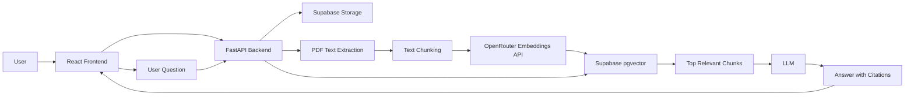

# Document Intelligence RAG Assistant

A small, evidence-first Retrieval-Augmented Generation application. Upload PDF
documents, index their text in Supabase pgvector, ask questions, and receive
answers with page-level citations that open the original source.

## Features

- Drag-and-drop PDF uploads with type, signature, and size validation
- Page-wise text extraction with PyMuPDF
- Page-preserving dependency-free chunking
- Remote OpenRouter embeddings with a fixed 384-dimensional output
- Supabase Storage, PostgreSQL, and pgvector similarity search
- Optional lightweight vector/keyword hybrid scoring
- Configurable OpenAI-compatible LLM provider
- Citation validation: generated answers can only reference retrieved sources
- Conversation history, latency tracking, and answer feedback
- Responsive React, TypeScript, Tailwind, and React Markdown interface
- Backend unit tests and a small API-based evaluation script

## Architecture



The Supabase service-role key and LLM key are used only by FastAPI. They must
never be added to the frontend environment.

## Repository structure

```text
document-rag-assistant/
├── backend/
│   ├── app/
│   │   ├── routes/
│   │   ├── services/
│   │   ├── config.py
│   │   ├── main.py
│   │   ├── models.py
│   │   ├── prompts.py
│   │   ├── schemas.py
│   │   └── supabase_client.py
│   ├── scripts/
│   ├── tests/
│   ├── .env.example
│   ├── Dockerfile
│   ├── requirements-dev.txt
│   └── requirements.txt
├── frontend/
│   ├── src/
│   ├── .env.example
│   ├── Dockerfile
│   └── package.json
├── supabase/schema.sql
├── docker-compose.yml
├── render.yaml
└── README.md
```

## 1. Supabase setup

1. Create a Supabase project.
2. Open **SQL Editor**, paste the complete contents of
   `supabase/schema.sql`, and run it.
3. Confirm that the `documents` bucket exists under **Storage** and is private.
4. In **Project Settings → API**, copy the project URL and service-role key.
5. Keep the service-role key on the backend only.

The schema enables `vector`, creates all five application tables, adds an HNSW
cosine index, creates the `match_document_chunks` RPC, enables RLS, and creates
the private 25 MB PDF bucket. The backend uses the service role, which bypasses
RLS; no anonymous table or bucket policies are required for this MVP.

If the SQL editor reports that HNSW is unavailable, update the project's
pgvector extension and rerun the index statement.

## 2. Backend configuration and startup

Python 3.11 is recommended.

```powershell
cd backend
python -m venv .venv
.\.venv\Scripts\Activate.ps1
pip install -r requirements-dev.txt
Copy-Item .env.example .env
```

Set these values in `backend/.env`:

```env
SUPABASE_URL=https://your-project.supabase.co
SUPABASE_SERVICE_ROLE_KEY=your-service-role-key
LLM_API_BASE=https://openrouter.ai/api/v1
LLM_API_KEY=your-provider-key
LLM_MODEL=your-model-name
EMBEDDING_MODEL=openai/text-embedding-3-small
EMBEDDING_DIMENSIONS=384
FRONTEND_URL=http://localhost:5173
```

OpenRouter is the default OpenAI-compatible provider. Set `LLM_API_KEY` to your
OpenRouter key and `LLM_MODEL` to a valid OpenRouter chat model slug. The same
key calls OpenRouter's embeddings endpoint. Other defaults—including chunk
size, overlap, top-k, and similarity threshold—are documented in
`backend/.env.example`.

Run the API:

```powershell
uvicorn app.main:app --reload --host 0.0.0.0 --port 8000
```

Verify process health at `http://localhost:8000/health`, Supabase readiness at
`http://localhost:8000/ready`, and explore interactive API documentation at
`http://localhost:8000/docs`.

Embedding inference runs remotely, so the FastAPI process does not load PyTorch
or a transformer model.

## 3. Frontend configuration and startup

Node.js 20 or newer is recommended.

```powershell
cd frontend
npm install
Copy-Item .env.example .env
npm run dev
```

Open `http://localhost:5173`. For a deployed build, set `VITE_API_URL` to the
public FastAPI origin before running `npm run build`.

## Docker

Create `backend/.env` first, then from the repository root run:

```powershell
docker compose up --build
```

The frontend is available on port 5173 and FastAPI on port 8000. Supabase stays
hosted; this project intentionally does not run a second PostgreSQL container.

For a remote frontend, override the frontend build argument and set
`FRONTEND_URL` in the backend to the deployed frontend origin.

## Deploying on the Render free tier

`render.yaml` at the repository root deploys the backend as a native Python
service sized for the free instance (512 MB RAM, 0.1 CPU, spin-down after
15 idle minutes). Design decisions that make it fit:

- **Nothing heavy runs locally.** Embeddings and generation are remote API
  calls (OpenRouter), vectors live in Supabase pgvector, and PDFs live in
  Supabase Storage. The process only parses PDFs (PyMuPDF) and orchestrates
  HTTP calls, so idle memory stays low.
- **Uploads are capped at 10 MB** (`MAX_PDF_SIZE_MB=10`) so one in-flight
  ingestion (PDF bytes + chunks + embeddings) stays well under 512 MB.
- **Single worker, bounded concurrency.** The start command runs uvicorn with
  `--workers 1 --limit-concurrency 12` so a burst of requests queues instead
  of exhausting memory on 0.1 CPU.
- **Interrupted ingestions self-heal.** Ingestion runs in-process, and a
  spin-down or deploy can kill it mid-flight. On startup the backend removes
  partial chunks and the stored PDF, then marks any document still in
  `processing` as `failed` with a clear message.
- **Cold starts are masked.** The frontend pings `/health` as soon as it
  loads, so the instance is already waking (up to ~1 minute) while the user
  reads the page; API calls use generous timeouts.

Steps: create a Render Blueprint from the repo, then set the four prompted
values (`SUPABASE_URL`, `SUPABASE_SERVICE_ROLE_KEY`, `LLM_API_KEY`,
`LLM_MODEL`). After the first deploy, update `FRONTEND_URL` to the deployed
frontend origin. Host `frontend/` as a Render Static Site with build command
`npm install && npm run build`, publish directory `dist`, and `VITE_API_URL`
pointing at the backend URL. A second Render web service is unnecessary for
static files.

## API endpoints

| Method | Endpoint | Purpose |
|---|---|---|
| GET | `/health` | Service health |
| GET | `/ready` | Service and Supabase readiness |
| POST | `/api/documents/upload` | Validate, store, and begin PDF ingestion |
| GET | `/api/documents` | List documents |
| GET | `/api/documents/{id}` | Read document metadata |
| GET | `/api/documents/{id}/status` | Read processing status |
| DELETE | `/api/documents/{id}` | Delete PDF, metadata, and chunks |
| POST | `/api/chat` | Retrieve evidence and create a cited answer |
| POST | `/api/conversations` | Create a conversation |
| GET | `/api/conversations` | List conversation history |
| GET | `/api/conversations/{id}/messages` | List messages |
| DELETE | `/api/conversations/{id}` | Delete a conversation |
| POST | `/api/feedback` | Save positive or negative feedback |

## How ingestion works

1. FastAPI validates the extension, MIME type, `%PDF-` signature, and byte size.
2. The PDF is uploaded under a UUID-based path in the private Storage bucket.
3. A `processing` metadata record is returned immediately.
4. A FastAPI background task extracts non-empty pages.
5. Each page is split independently into overlapping chunks.
6. OpenRouter creates normalized 384-dimensional embeddings in batches.
7. Chunks and their 384-dimensional vectors are inserted into Supabase.
8. The record becomes `completed`; failures are logged server-side and expose
   only a safe generic error.

Scanned/image-only PDFs fail clearly because OCR is outside this MVP.

## How retrieval and citations work

The question is embedded with the same OpenRouter embedding model and sent to
the `match_document_chunks` Supabase RPC. Results below `MIN_SIMILARITY` are
discarded for specific fact questions. Broad document-overview and summary
requests use the nearest chunks when that cutoff would otherwise remove every
candidate. The RPC only searches documents whose ingestion status is
`completed`. When `HYBRID_SEARCH=true`, a small keyword score is blended with
the vector score.

Retrieved chunks receive source IDs (`S1`, `S2`, and so on) before the LLM call.
The prompt requires the model to answer only from this context. After
generation, unknown source IDs are removed, and the API returns metadata only
for citations actually present in the answer. The frontend displays inline
links and supporting source cards with signed private-PDF URLs.

## Tests

Install `requirements-dev.txt`, then from `backend` with the virtual environment
active:

```powershell
pytest -q
```

The tests cover text cleaning and PDF page retention, page-safe chunking,
OpenRouter embedding response handling, context construction, and rejection of
invented citation IDs.

## Evaluation

Copy `backend/scripts/evaluation_questions.example.json` and replace its sample
with questions grounded in the PDFs already uploaded to your running instance.
Then run:

```powershell
cd backend
python scripts/evaluate.py --questions scripts/evaluation_questions.example.json
```

Use `--api-url` for a non-local backend. The script reports expected-document
retrieval, expected-keyword answers, citation presence, and average end-to-end
latency.

## Screenshots

Add final deployment screenshots here after configuring Supabase and the LLM:

- Documents page with a completed upload
- Chat answer with inline citation and source card

## Known limitations

- No authentication or tenant isolation
- No OCR for scanned PDFs
- PDF only
- Background tasks run inside the API process; interrupted ingestions are
  cleaned up and marked `failed` at the next startup rather than resumed
- Every question is retrieved independently
- Citation validation verifies source IDs, not semantic entailment
- The simple optional keyword blend is not full-text hybrid retrieval

## Future improvements

Supabase Auth, scanned-PDF OCR, DOCX support, cross-encoder reranking, proper
keyword/vector hybrid retrieval, streaming responses, conversation-aware query
rewriting, advanced RAG evaluation, an admin dashboard, document summarization,
and multi-document comparison are intentionally left for future versions.
